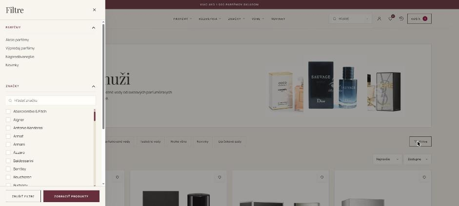
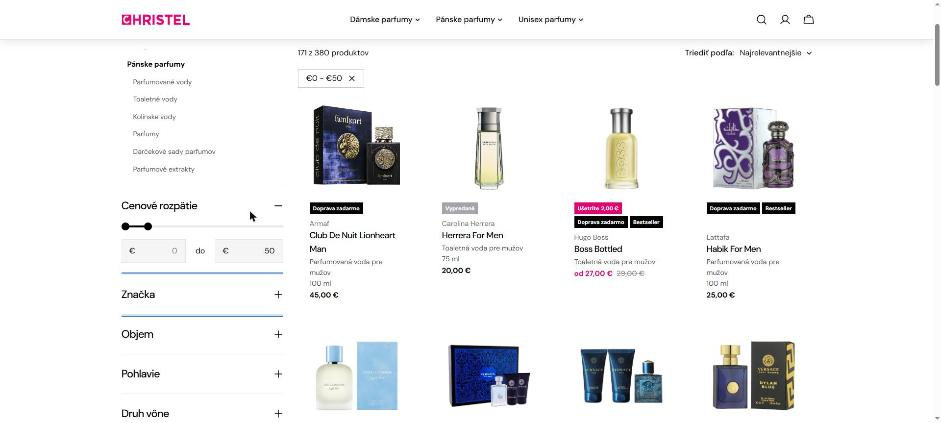
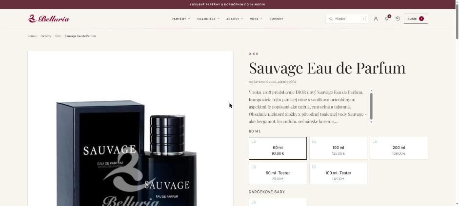
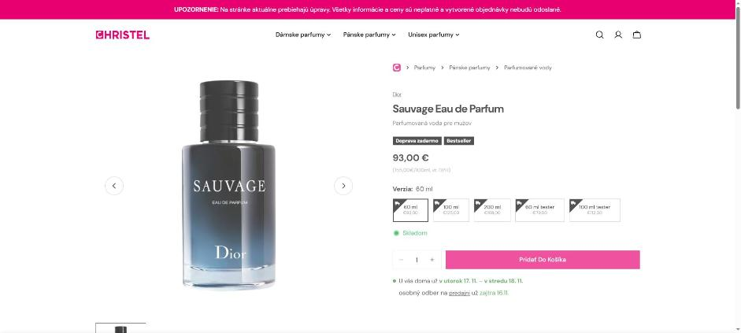
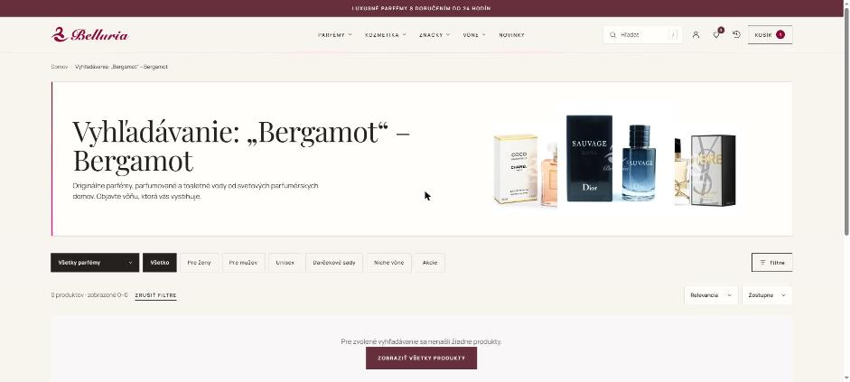
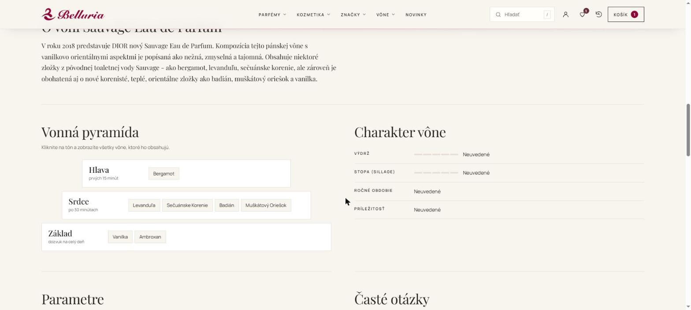
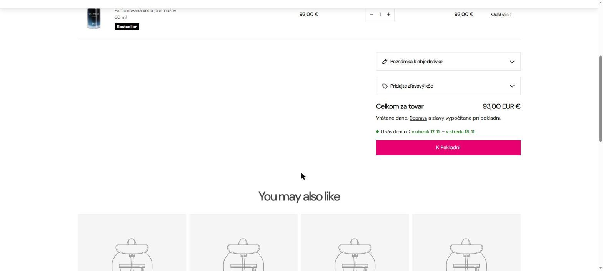
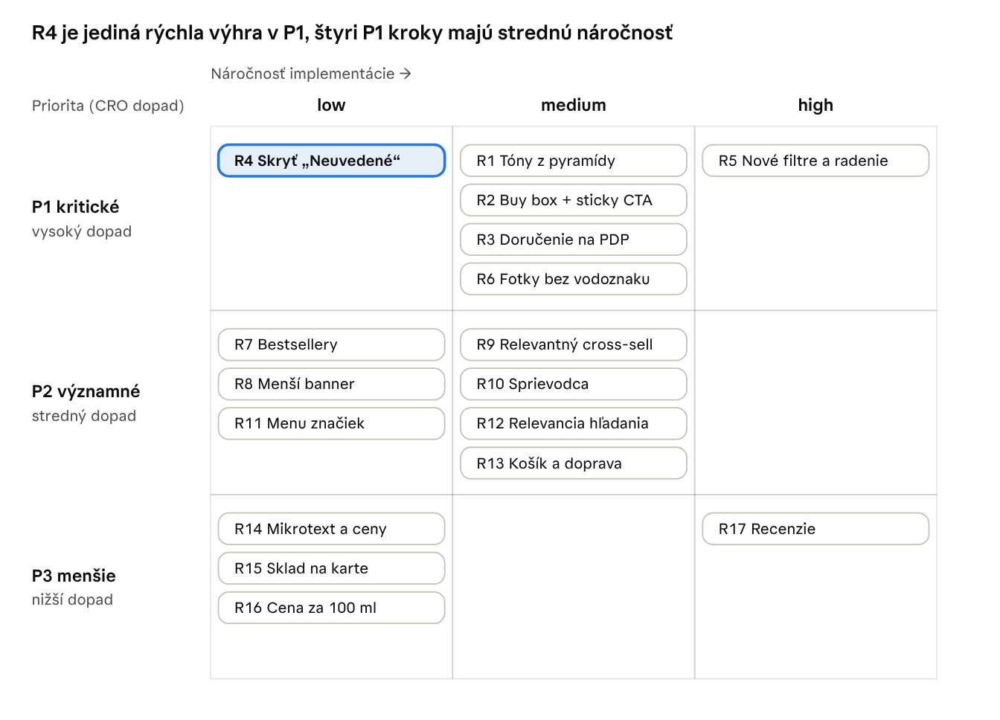

# UX/UI usability test: Belluria.sk vs. Christel.sk

15. 11. 2026 · Lukas

## Rozsah testu

Testované 15. 11. 2026 v Chrome na desktope (1568 × 705 px) a v simulovanom mobile (390 px). Každý scenár som prešiel na oboch e-shopoch ako zákazník.

- **Vylúčené na tvoju žiadosť:** checkout, vypredané produkty (chyba skladu) a oznam o úpravách na Christel. Košík je hodnotený, checkout nie.
- **Kliky** sú počty z mojej cesty (hover sa nepočíta). **Čas** som spoľahlivo nemeral, preto ho neuvádzam.
- **Mobil:** Belluria cez 390 px iframe (spoľahlivé). Christel cez 390 px náhľad bez plného JS, takže rozloženie výpisu produktov na mobile Christel je neisté.
- **Fakty vs. hypotézy:** zistenia sú pozorované. Dopad na konverzie je odhad podľa UX princípov (Baymard, NN/g), nie meranie. Bez analytiky alebo A/B testu ho nemožno potvrdiť.

## Executive summary

**Christel.sk je použiteľnejší: vážené skóre 7,0 / 10 oproti 6,1 / 10 pre Belluria.sk.** Christel vyhral 9 z 15 scenárov, Belluria 4 a 2 skončili remízou.

Christel vyhráva v tých častiach, ktoré rozhodujú o kúpe: v produktovom detaile a vo filtroch. Cena, varianty a CTA sú nad záhybom, na stránke je dátum doručenia a pri scrollovaní ostáva viditeľná lišta s tlačidlom do košíka. Filtre majú presný cenový rozsah, druh vône, dostupnosť a počty.

Belluria má silný koncept objavovania: vyhľadávanie s návrhmi tónov a značiek, index značiek A–Z, sprievodcu výberom a klikateľnú vonnú pyramídu. Exekúcia ho však podrýva:

- **14 z 24 tónov v menu VÔNE vráti 0 produktov** (napr. Bergamot, Levanduľa, Tonka). Ostatné vrátia 1–16 produktov, lebo ide o fulltext v názve, nie o dáta z pyramídy.
- Na PDP je cena aj CTA pod záhybom, chýba sticky CTA a všetky 4 polia „Charakter vône“ ukazujú „Neuvedené“.
- Filtre majú iba značku, 4 pevné cenové pásma a príznaky (akcia, bestseller). Chýba druh vône, dostupnosť aj objem.

Christel má vlastné chyby, ktoré podkopávajú dôveru: v košíku je šablónový blok „You may also like“ so štyrmi produktmi „Príklad názvu produktu 19,99 €“ a suma „93,00 EUR €“. Tiež nemá index značiek, akcie v hlavičke ani wishlist.

**Najväčší potenciál pre Belluria (P1):** opraviť stránky tónov, posunúť nákupný box na PDP nahor a pridať sticky CTA, ukázať dátum a cenu doručenia a prebudovať filtre podľa vzoru Christel.

## Celkové bodové porovnanie

Christel vedie o 0,9 bodu. Rozdiel tvorí hlavne produktový detail (+3) a filtre (+2). Belluria vedie iba vo výpise produktov (+0,5).

| Oblasť | Váha | Belluria | Christel | Rozhodujúce pozorovania |
| --- | --- | --- | --- | --- |
| Navigácia a orientácia | 20 % | 6 | 6 | B: bohaté mega menu a index značiek A–Z, ale nefunkčné tóny vo VÔNE a duplicity v taxonómii. C: čisté menu podľa pohlavia s bestsellermi, ale bez akcií, darčekov a značiek v hlavičke. |
| Vyhľadávanie a filtre | 15 % | 6 | 8 | B: výborný autocomplete (tóny, značky, „Mysleli ste?“), ale slabé filtre v zásuvke. C: filtre s počtami, druhom vône, dostupnosťou a presnou cenou, sémantické vyhľadávanie. |
| Produktový výpis | 15 % | 7 | 6,5 | B: veľké karty a rýchle pridanie do košíka, ale banner kategórie tlačí produkty pod záhyb. C: zľavy a odznaky, ale bez rýchleho pridania a s preplnenými odznakmi. |
| Produktový detail | 20 % | 5 | 8 | B: CTA pod záhybom, vodoznak cez produkt, 4× „Neuvedené“. C: nákupný box nad záhybom, dátum doručenia, sticky CTA, jednotková cena. |
| Košík (bez checkoutu) | 20 % | 6 | 6,5 | B: prehľadný, ale bez ceny dopravy a s 2-krokovým výberom darčeka. C: info o doprave zdarma a upsell, ale šablónové produkty a „EUR €“. |
| Vizuálna hierarchia | 10 % | 7 | 7 | B: konzistentná prémiová identita, drobné nízkokontrastné popisky. C: kontrastné CTA, ale veľa odznakov a prázdne miesta pri animáciách načítania. |
| **Vážené skóre** | 100 % | **6,1** | **7,0** | |

Skóre som zaokrúhlil na desatiny (6,05 a 6,98). Body vyjadrujú moje hodnotenie, nie meranie. Opierajú sa však o konkrétne pozorovania uvedené v ďalších sekciách.

## Výsledky nákupných scenárov

**Christel 9 výhier, Belluria 4, remíza 2.** Belluria vyhráva tam, kde zákazník hľadá značku, akciu, darček alebo si chce produkty odložiť. Christel vyhráva pri filtrovaní, dostupnosti, doprave a rozhodovaní na PDP. Kliky sú z mojej cesty a hover sa nepočíta.

| # | Scenár (štart) | Belluria: cesta · kliky · výsledok | Christel: cesta · kliky · výsledok | Víťaz |
| --- | --- | --- | --- | --- |
| 1 | Konkrétny parfum, Dior Sauvage EdP (HP) | Viditeľné pole → autocomplete → produkt · 2 · áno, preklep „sauvge“ ponúkne „Mysleli ste Sauvage?“ | Ikona lupy → zásuvka → produkt · 2 · áno, preklep tichý, ale správny | Remíza |
| 2 | Pánske parfémy do 50 € (HP) | Menu → Pánske → Filtre → 31–60 € → Zobraziť → 2 selecty radenia · 8 · čiastočne: hranicu 50 € nejde nastaviť a aktívny filter nie je vidieť | Menu → Pánske → pole „do“ = 50 · 2 · áno, 171 z 380 a chip „€0 – €50 ד | Christel |
| 3 | Dámsky parfum na každodenné nosenie (HP) | Sprievodca: Každý deň → Svieže → Do 100 € · 4 · čiastočne: 479 výsledkov aj s pánskymi, bez otázky na pohlavie | Dámske → filter Druh vône (Svieža, Kvetinová… s počtami) · ~3 · áno, ale bez atribútu „na každý deň“ | Christel |
| 4 | Značka bez názvu produktu, Montblanc (HP) | Značky → Parfumérske domy A–Z → M → Montblanc · 3 · áno | Index značiek chýba, v menu je iba 6 top značiek. Vyhľadávanie alebo filter Značka · 2–3 · áno, ale iba ako zoznam produktov | Belluria |
| 5 | Najpredávanejšie parfémy (HP) | Na HP nie sú. Kategória → Filtre → Najpredávanejšie → Zobraziť · 4 · áno, ale skryté | Sekcia na HP (0), menu „Najpredávanejšie dámske/pánske“ (1), radenie · 0–1 · áno | Christel |
| 6 | Porovnať dva podobné parfémy (PDP) | Porovnanie chýba. Srdiečko (wishlist) a „Moja história“ · 1 na produkt · čiastočne | Porovnanie ani wishlist nie sú, iba „Naposledy prezerané“ · – · čiastočne (karty v prehliadači) | Belluria (tesne) |
| 7 | Darček pre ženu (HP) | Parfémy → Dámske → Darčekové sady · 1 · áno (68 položiek), k objednávke darček zadarmo | Hero „Vybrať vianočný darček“ vedie na všetky parfumy, nie na darčeky. Cez menu Dámske → Darčekové sady · 1 · áno | Belluria |
| 8 | Darčeková sada (HP) | Menu → Darčekové sady podľa pohlavia · 1 · áno. Sady sa ukazujú aj na PDP pri variantoch | Menu → Sortiment → Darčekové sady · 1 · áno (71). Sada aj v „Súvisiace produkty“ na PDP | Remíza |
| 9 | Cenové rozpätie 60–100 € (kategória) | Filtre → 61–100 € → Zobraziť · 3 · áno, iba pevné pásma. Na HP sú chipy „Do 30/50/100/200 €“ | Dve polia od–do (alebo posuvník) · 2 · áno, presne | Christel |
| 10 | Alternatíva k Baccarat Rouge 540 (HP) | Vyhľadávanie „baccarat“ → 1 výsledok, cross-sell na PDP nesúvisí · – · nie | „baccarat“ v návrhoch ukáže aj Club De Nuit Untold a Ana Abiyedh Rouge · 1 · áno, ale bez označenia „alternatíva“ | Christel |
| 11 | Je parfum skladom? (kategória) | Iba na PDP „Na sklade“, na karte ani vo filtri nie · 1 · áno | PDP „Skladom“ + dátum doručenia + osobný odber. Vo výpise filter Dostupnosť (napr. pánske do 50 €: Skladom 108 / Na objednávku 62) · 0–1 · áno | Christel |
| 12 | Doprava a platba (HP) | Pätička → stránka uvádza iba kuriéra 4,90 €. Lišta sľubuje „doručenie do 24 hodín“, stránka „do 2 pracovných dní od expedovania“ · 1 · čiastočne | Dátum doručenia už na PDP. Stránky: Packeta 2,90 €, kuriér 4,90 €, ČR 6,90 €. Hranica dopravy zdarma nie je nikde uvedená · 0–1 · áno | Christel |
| 13 | Akcia alebo zľava (HP) | Menu Parfémy → Akcie, alebo HP „Zobraziť všetky akcie“ · 1 · áno (28) | Hlavička ich nemá. Iba HP karusel „Zvýhodnená ponuka“ a pätička „Akciové“ · 1 + scroll na koniec · áno (45) | Belluria |
| 14 | Hlava, srdce, základ a výdrž (PDP) | Vizuálna pyramída s časmi (15 min, 30 min). Výdrž, stopa, obdobie a príležitosť = „Neuvedené“ · 0 · čiastočne | Tabuľka pyramídy, druh vône, koncentrácia, popis s parfumérom a použitím („Na deň aj na večer“) · 0 · áno, výdrž nie je ani tu | Christel |
| 15 | Z PDP do košíka (PDP) | Scroll k CTA → Do košíka → Prejsť do košíka · 2 + scroll · áno | Sticky „Pridať do košíka“ → Do košíka alebo K pokladni · 2 · áno, s informáciou o doprave zdarma | Christel |

## Detailné porovnanie častí

Belluria je silná v homepage a objavovaní. Christel je silný v PDP, filtroch a košíku. Pod každou tabuľkou je lepší e-shop pre danú časť.

### A. Homepage

| Aspekt | Belluria | Christel |
| --- | --- | --- |
| Hodnotová ponuka | „Parfuméria od roku 2007“, 4 USP (100 % originály, darček zadarmo, vyzdvihnutie, rýchle doručenie) a pole vyhľadávania priamo v hero | Sezónny hero „Darček, ktorý vonia výnimočne“, USP sú až na PDP |
| Orientácia nového zákazníka | Značky, rodiny vôní, filter „Nájdite svoj pocit“, cenové chipy, sprievodca | Naposledy prezerané, Najpredávanejšie, Zvýhodnená ponuka, Novinky, články |
| Bestsellery | Sekcia chýba | Sekcia s odznakom Bestseller |
| Problémy | Karty rodín vôní a „Objaviť kolekciu“ vedú na „/“, teda iba odscrollujú na sekciu na HP. Výsledok sa nedá zdieľať a chýba v ňom filter pohlavia | CTA hero vedie na všetky parfumy, nie na darčeky. Sekcie sa pri scrolle napĺňajú animáciou, takže chvíľu sú prázdne. „Novinky“ obsahujú aj Sauvage |

Lepšie: **Belluria** (jasnejšia ponuka a viac vstupov do objavovania), ale bez bestsellerov.

### B. Hlavička a navigácia

| Aspekt | Belluria | Christel |
| --- | --- | --- |
| Hlavné menu | Parfémy, Kozmetika, Značky, Vône, Novinky | Dámske, Pánske, Unisex parfumy |
| Mega menu | Pohlavie × typ (parfém, EdP, EdT, niche, novinky, sady). Značky zobrazujú iba prvých 15 abecedne (A–L). VÔNE má 24 tónov, z toho 14 vráti 0 produktov | Najpredávanejšie, Novinky, Sortiment, 6 top značiek, Špeciálne ponuky, produkty „Výber zákazníkov“. Pri prvom hoveri sa na chvíľu zobrazí prázdny biely panel |
| Taxonómia | Duplicity: „Dezodoranty a antiperspiranty“ pod Parfémami a „Deodoranty“ pod Kozmetikou, darčekové sady na dvoch miestach, značky „Karl Lagerfeld“ aj „Lagerfeld“. Položka „Parfémy“ znamená koncentráciu aj celú kategóriu | „parfumy“ v hlavičke a „parfémy“ v pätičke. Akcie, darčeky ani značky nie sú na prvej úrovni |
| Vyhľadávanie, konto, košík | Viditeľné pole so skratkou „/“, konto, wishlist, história, košík s počtom | Iba ikony: lupa, konto, košík. Wishlist chýba |
| Sticky hlavička | Áno, stále viditeľná | Pri scrolle nadol sa skrýva |
| Mobil | Hamburger s akordeónom. V hlavičke 5 ikon tesne vedľa seba | Drill-down menu s bestsellermi a karuselom produktov. Toaletné vody sú až na 3. úrovni |

Lepšie: **remíza**. Belluria má širší prístup k značkám a akciám, ale nefunkčné VÔNE. Christel je prehľadnejší, ale plytký.

### C. Výpis produktov (PLP)

| Aspekt | Belluria | Christel |
| --- | --- | --- |
| Karta | Značka, názov, typ a objem, cena, „Do košíka“, srdiečko | Značka, názov, typ, cena „od“, „Ušetríte X €“, odznaky. Rýchle pridanie chýba |
| Fotky | Veľké, jednotné, časť s vodoznakom Belluria | Menšie, bez vodoznaku |
| Odznaky | Novinka, Akcia | „Doprava zadarmo“ takmer na každej karte, takže stráca význam. K tomu Bestseller, Novinka, Ušetríte |
| Filtre | Zásuvka z ľavej strany, hoci tlačidlo je vpravo. Príznaky, značka (s vyhľadávaním), 4 cenové pásma (radio). Aplikácia cez reload, bez chipov aktívnych filtrov | Stály bočný panel: cena od–do, značka s počtami a vyhľadávaním, objem v ml, pohlavie, druh vône (16+ typov s počtami), dostupnosť. AJAX a chipy aktívnych filtrov |
| Radenie | Dva selecty: Najnovšie / Podľa názvu / Podľa ceny + Vzostupne / Zostupne | Jeden select: Najrelevantnejšie, Najpredávanejšie, Od najlacnejších, Od najdrahších |
| Orientácia | Banner kategórie (~300 px) tlačí produkty pod záhyb a na mobile zaberá celú prvú obrazovku. Na banneri „Parfémy muži“ je Chanel Coco a YSL Libre, na „Parfémy ženy“ Sauvage. Stránkovanie 24 / strana | Breadcrumb, podkategórie a počet „171 z 380 produktov“. Produkty sa pri načítaní objavujú animáciou |

Lepšie: **Belluria** pri kartách (rýchle pridanie, čistota), **Christel** pri filtroch a radení.

Belluria, /parfemy-muzi/: filtre v zásuvke z ľavej strany, cena iba ako 4 pásma.

Christel, Pánske parfumy: presná cena, „171 z 380 produktov“ a chip aktívneho filtra.

### D. Produktový detail (PDP), Dior Sauvage EdP

| Aspekt | Belluria | Christel |
| --- | --- | --- |
| Fotka | Veľká, ale vodoznak „Belluria“ cez stred produktu | Čistý packshot, iba 1 fotka |
| Cena, varianty | Dlaždice s cenou pre každý objem aj testery, sady ako samostatná skupina. Cena 93.00 € s bodkou | Cena + jednotková cena (155,00 €/100 ml). Malé dlaždice, ikona dodávky prekrýva text |
| CTA | Pod záhybom na desktope, na mobile až po ~2 obrazovkách. Sticky CTA chýba. Popis je v boxe s vlastným scrollom | Nad záhybom. Sticky lišta s výberom objemu, množstvom a CTA |
| Dostupnosť, doručenie | „Na sklade“. „Doprava a platba podľa vášho výberu v košíku“, bez ceny a dátumu | „Skladom“, „U vás doma už v utorok 17. 11. – v stredu 18. 11.“, osobný odber zajtra |
| Info o vôni | Pyramída s časmi a klikateľnými tónmi, ktoré vedú na 0 alebo málo výsledkov. „Charakter vône“ = 4× „Neuvedené“. FAQ odkazuje „vyššie“ na prázdne polia | Editoriálny popis (rok, parfumér, použitie), tabuľka pyramídy, druh vône, koncentrácia |
| Recenzie | Nie | Nie |
| Cross-sell | „Mohlo by vás zaujímať“: Jimmy Choo Fever a Moschino I Love Love (dámske) pri pánskom Sauvage | „Podobné produkty“: Sauvage Parfum, Elixir, Eau Forte, Eau Sauvage. Sada v „Súvisiace“ |

Lepšie: **Christel**, jasne.

Belluria, PDP nad záhybom (1568 × 705): vodoznak cez produkt, popis v boxe so scrollom, cena ani CTA nie sú vidieť.

Christel, rovnaký výrez: cena, jednotková cena, varianty, dostupnosť, CTA a dátum doručenia.

### E. Košík (checkout vylúčený)

| Aspekt | Belluria | Christel |
| --- | --- | --- |
| Po pridaní | Zásuvka „Pridané do košíka“, obsah, suma, „Prejsť do košíka“ / „Pokračovať v nákupe“ | Zásuvka s „Máte nárok na bezplatnú dopravu“, úprava množstva, upsell, dátum doručenia. Dve rovnako výrazné CTA „Do košíka“ a „K pokladni“ |
| Množstvo, odstránenie | Select 0–10 ks, odkaz Odstrániť | Stepper +/−, Odstrániť |
| Doprava | „Vyberiete v pokladni“, bez ceny aj bez hranice zdarma | Progress bar „Máte nárok na bezplatnú dopravu“ |
| Zľavový kód | Viditeľné pole hore v súhrne | Zbalené „Pridajte zľavový kód“ |
| Darček | Výber darčeka (Vialky z mixu, Pero) vyžaduje samostatné „Uložiť výber“ | – |
| Chyby | „1 produktov“, „2 produktov“, desatinná bodka | „93,00 EUR €“, šablónový blok „You may also like“ so 4× „Príklad názvu produktu 19,99 €“, hlavička stĺpca „cena“ malým |

Lepšie: **Christel** v toku, **Belluria** v dôveryhodnosti obsahu. Po oprave šablóny je Christel jasne lepší.

### F. Vyhľadávanie a objavovanie

| Aspekt | Belluria | Christel |
| --- | --- | --- |
| Autocomplete | Na šírku stránky: Tóny, Značky, Produkty s fotkou a cenou, zvýraznený dotaz | Zásuvka vpravo. Pred písaním „Najhľadanejšie výrazy“ a produkty. Potom iba produkty |
| Preklepy | „sauvge“ a „chanell“ ponúknu „Mysleli ste …?“ | Opravené potichu, výsledky sú správne |
| Relevancia | „dior“: 40 výsledkov, prvé je Diorissimo, nie Sauvage | „dior“: 60. „sauvage eau de parfum“ po Enter: 659, teda príliš široko |
| Sémantika | „vanilka“ nájde 1 produkt s názvom „Vanilla“ | „vanilka“ nájde parfémy s vanilkou. „baccarat“ ponúkne aj alternatívy |
| Prázdny výsledok | Generický text kategórie + „Zobraziť všetky produkty“ | Slepá ulička: iba text, žiadne produkty ani CTA |
| Pomoc pri výbere | Sprievodca (3 otázky). Chýba v ňom pohlavie, najnižší rozpočet je „Do 100 €“ a výsledkom je 479 nezoradených parfémov | Články (darček, výdrž, pyramída) a filter Druh vône |

Lepšie: **Belluria** v autocomplete a navigácii značiek, **Christel** vo výsledkoch a sémantike.

## Najväčšie UX problémy Belluria.sk

Najväčší problém je nefunkčné objavovanie podľa tónov: menu aj PDP sľubujú funkciu, ktorá vráti prázdnu stránku. Dopad na konverzie je hypotéza odvodená z UX princípov, nie meranie.

| # | Problém a lokalita | Prečo je to problém | Možný dopad | Riešenie |
| --- | --- | --- | --- | --- |
| 1 | **Tóny vo VÔNE a v pyramíde na PDP vedú na 0 produktov.** Menu VÔNE → Bergamot (/produkty/bergamot/) = 0. Rovnako Pomaranč, Mandarinka, Grapefruit, Levanduľa, Kosatec, Fialka, Pivonka, Céder, Kadidlo, Tonka, Pralinka, Karamel a Pižmo, spolu 14 z 24. Vanilka = 1 produkt (My Way Sunny Vanilla), hoci vanilku má v základe aj Sauvage EdP | Stránka tónu je fulltext v názve, nie dáta z pyramídy. PDP píše „Kliknite na tón a zobrazíte všetky vône, ktoré ho obsahujú“, čo nesedí. Porušuje to information scent a heuristiku zhody systému s realitou | Slepá ulička v jedinom unikátnom objavovacom kanáli a strata dôvery | Stránky tónov plniť z atribútov pyramídy (hlava, srdce, základ). Tóny s menej ako X produktmi v menu skryť |
| 2 | **Nákupný box na PDP je pod záhybom a chýba sticky CTA.** Desktop: cena a „Do košíka“ až po scrolle. Mobil: po ~2 obrazovkách. Krátky popis je v boxe s vlastným scrollom | Kľúčová akcia nie je vidieť (Fitts, Baymard: buy box above the fold). Vnorený scroll na mobile zachytáva gesto | Nižšia miera pridania do košíka, hlavne na mobile | Cenu a CTA dať hneď pod názov a varianty, popis skrátiť na 2 riadky a „Čítať viac“. Pridať sticky lištu s objemom a CTA |
| 3 | **„Charakter vône“ = 4× „Neuvedené“ a cyklické FAQ.** Na Sauvage EdP sú výdrž, stopa, obdobie aj príležitosť prázdne. FAQ „Ako dlho vydrží?“ odkazuje „vyššie“ | Prázdne polia pôsobia ako nedokončený web. Práve tieto informácie zákazník pri parfémoch hľadá | Nižšia dôvera a otázky na podporu | Prázdne polia nezobrazovať. FAQ generovať iba z vyplnených dát |
| 4 | **Slabé filtre na PLP.** Zásuvka z ľavej strany, tlačidlo vpravo. Iba značka, 4 pevné cenové pásma a príznaky. Chýba druh vône (hoci HP ho používa), dostupnosť, objem a koncentrácia. Bez chipov aktívnych filtrov a počtov. Radenie cez 2 selecty bez „Najpredávanejšie“ | „Do 50 €“ sa nedá zadať. Používateľ nevidí, čo má aktívne (viditeľnosť stavu, NN/g #1). 2 selecty na jedno radenie zvyšujú kognitívnu záťaž | Viac odchodov z kategórií | Viď odporúčanie R5 |
| 5 | **Vodoznak „Belluria“ cez stred produktu** na PDP aj na časti kariet | Zakrýva etiketu a pôsobí menej prémiovo. Zákazník nevidí produkt čisto | Nižšia dôvera v originálnosť | Vodoznak odstrániť, prípadne iba jemne do rohu |
| 6 | **Nejasná doprava.** Lišta „Luxusné parfémy s doručením do 24 hodín“, ale stránka Doprava uvádza „najneskôr do 2 pracovných dní od expedovania“ a iba kuriéra 4,90 €. HP pritom sľubuje aj vyzdvihnutie. Na PDP aj v košíku chýba cena aj dátum | Neočakávané náklady sú podľa Baymardu najčastejší dôvod opustenia košíka. Rozporný sľub znižuje dôveru | Opustenie košíka | Na PDP a v košíku ukázať dátum doručenia, cenu dopravy a možnosti. Zjednotiť sľub |
| 7 | **Banner kategórie** (~300 px) s nesprávnymi produktmi: Chanel Coco a YSL Libre na „Parfémy muži“, Sauvage na „Parfémy ženy“. Na mobile zaberá celú prvú obrazovku | Odsúva produkty, a teda hlavný obsah. Zlé obrázky mätú | Pomalší začiatok prehliadania | Banner zmenšiť na nadpis + 1 riadok a použiť správne obrázky |
| 8 | **Nesúvisiaci cross-sell** „Mohlo by vás zaujímať“: pri pánskom Sauvage sú dámske vône (Jimmy Choo Fever, Moschino I Love Love) | Odporúčania bez logiky strácajú dôveru aj klik | Nižší cross-sell | Odporúčať podľa pohlavia, rodiny vône a rovnakej línie |
| 9 | **Bestsellery sú skryté.** Na HP ani v menu nie sú, iba ako príznak v zásuvke filtrov | Sociálny dôkaz je pri parfémoch silná skratka rozhodovania | Dlhšie rozhodovanie | HP sekcia, položka v menu a radenie |
| 10 | **Taxonómia a značky.** Rozbalené menu Značky ukáže iba A–L (bez Dior, Chanel, Versace). Duplicity: Dezodoranty/Deodoranty, „Karl Lagerfeld“ aj „Lagerfeld“ | Najznámejšie značky nie sú vidieť. Duplicity mätú (Hickov zákon) | Pomalšia navigácia | Ukázať top značky podľa predaja + „Všetky značky A–Z“. Zlúčiť duplicity |
| 11 | **Sprievodca výberom** nemá otázku na pohlavie, najnižší rozpočet je „Do 100 €“ a výsledok je iba sekcia HP so 479 parfémami. Odpoveď na 1. otázku sa vo výsledku neprejaví | Sľub personalizácie sa nesplní | Využitie bez konverzie | Viď R10 |
| 12 | **Mikrotext a formáty.** „1 produktov“, „2 produktov“. Ceny s bodkou (93.00 €) v PLP, PDP aj košíku. Titulok „Vyhľadávanie: „Vanilka“ – Vanilka“ | Drobné, ale opakované signály nekvality | Dôvera | Slovenské tvary čísla, desatinná čiarka |
| 13 | **Prázdny výsledok vyhľadávania** zobrazí generický text kategórie a jedno CTA | Zákazník nedostane žiadnu pomoc | Odchod | Návrhy, bestsellery, kontakt |

Problém 1: VÔNE → Bergamot, „0 produktov“.

Problém 3: „Charakter vône“ na Sauvage EdP, 4× „Neuvedené“.

## Najväčšie UX problémy Christel.sk

Najväčšie problémy Christel sú nedokončené šablónové prvky v košíku a plytká navigácia mimo pohlavia. Vypredané produkty a oznam o úpravách sú vylúčené.

| # | Problém a lokalita | Prečo je to problém | Možný dopad | Riešenie |
| --- | --- | --- | --- | --- |
| 1 | **Šablónové produkty v košíku.** /cart: blok „You may also like“ (po anglicky) so 4× „Príklad názvu produktu 19,99 €“ a ikonou batohu | V najcitlivejšom bode nákupu pôsobí web nedokončene | Strata dôvery tesne pred platbou | Blok napojiť na odporúčania (Shopify recommendations) alebo vypnúť |
| 2 | **„93,00 EUR €“** v zásuvke aj na stránke košíka | Zdvojená mena pri celkovej sume | Drobná strata dôvery | Opraviť formát meny v téme (money_with_currency_format) |
| 3 | **Navigácia iba podľa pohlavia.** Akcie, darčekové sady, značky ani bestsellery nie sú na prvej úrovni. Index značiek A–Z chýba, v menu je 6 top značiek. Akcie sú iba v pätičke | Zákazník s cieľom „akcia“ alebo „značka X“ nemá priamu cestu (information scent) | Odchod lovcov zliav a fanúšikov značiek | Pridať do hlavičky Značky (A–Z), Akcie a Darčeky |
| 4 | **Prázdny mega panel.** Pri prvom hoveri na „Dámske parfumy“ sa na chvíľu zobrazí veľký biely panel bez obsahu, obsah sa dočíta až potom | Pôsobí ako chyba. Používateľ môže odísť myšou skôr, než sa obsah objaví | Nižšie využitie menu | Predrenderovať obsah menu alebo zobraziť kostru (skeleton) |
| 5 | **Hero „Vybrať vianočný darček“ vedie na všetky parfumy** (/collections/parfumy), nie na darčeky ani sady | Klik nesplní sľub tlačidla (information scent) | Najviditeľnejší sezónny vstup sa mrhá | Viesť na darčekové sady alebo darčekový výber podľa príjemcu a rozpočtu |
| 6 | **„Doprava zadarmo“ takmer na každej karte, hranica nie je nikde uvedená** (stránka doručenia ani FAQ ju nemajú) | Odznak na všetkom stráca informačnú hodnotu. Zákazník nevie, od akej sumy doprava zdarma platí | Prekvapenie v košíku | Hranicu uviesť v lište, na PDP aj na stránke doručenia. Odznak dať iba tam, kde niečo rozlišuje |
| 7 | **Karty bez rýchleho pridania a preplnené odznakmi** (až 4 na karte) | Každý nákup vyžaduje návštevu PDP. Vizuálny šum (kognitívna záťaž) | Pomalší nákup opakovaných zákazníkov | Rýchle pridanie pri produktoch s 1 variantom, najviac 2 odznaky |
| 8 | **Prázdny výsledok vyhľadávania je slepá ulička** a plné vyhľadávanie je príliš široké („sauvage eau de parfum“ = 659 výsledkov) | Nulový výsledok bez cesty ďalej. Pri širokom dotaze výsledky zahlcujú | Odchod | Návrhy, bestsellery a kategórie pri nule. Pri viacslovnom dotaze uprednostniť zhodu všetkých slov |
| 9 | **Hlavička sa pri scrollovaní skrýva a vyhľadávanie je iba ikona** | Vyhľadávanie je hlavná cesta pri známom produkte (recognition over recall) | Pomalší prístup k vyhľadávaniu | Viditeľné pole na desktope, hlavičku nechať sticky |
| 10 | **Wishlist chýba** | Parfémy sa vyberajú dlho a porovnávajú. Bez odloženia sa zákazník stráca | Nižší návrat | Wishlist v hlavičke aj na kartách |
| 11 | **PDP: iba 1 fotka a malé dlaždice variantov**, ikona dodávky prekrýva text objemu. Na mobile majú dlaždice ~70 × 45 px | Fittsov zákon: malé ciele, chybné ťuknutia | Chyba vo výbere objemu | Väčšie dlaždice bez prekrytia. Doplniť fotku krabičky a detailu |
| 12 | **Nekonzistentný obsah.** „parfumy“ v hlavičke a „parfémy“ v pätičke, „Parfum pre ženy 100 m“ (Divine Elixir), Sauvage v Novinkách, voda po holení Boss Bottled medzi bestsellermi | Drobné, ale opakované signály nekvality | Dôvera | Redakčná kontrola a pravidlá pre Novinky |

Problém 1 a 2: /cart, „93,00 EUR €“ a „You may also like“ so šablónovými produktmi.

## Najlepšie UX riešenia z oboch e-shopov

Z Christel sa oplácá prevziať hlavne nákupný box na PDP a filtre. Z Belluria by mal Christel prevziať vyhľadávanie a index značiek.

**Z Christel.sk do Belluria.sk**

| Riešenie | Kde na Christel | Prečo funguje |
| --- | --- | --- |
| Sticky lišta s objemom, množstvom a CTA | PDP pri scrollovaní | CTA je stále na dosah, aj po čítaní popisu |
| Dátum doručenia + osobný odber na PDP a v košíku | Pod CTA | Odpovedá na otázku „kedy to bude doma“ v momente rozhodnutia |
| Jednotková cena (€/100 ml) | Pod cenou na PDP | Uľahčuje porovnanie objemov |
| Bočné filtre s počtami, druh vône, dostupnosť, objem a presná cena, chipy aktívnych filtrov | PLP a výsledky vyhľadávania | Rieši scenáre 2, 3, 9 a 11 za 1–2 kliky |
| Jedno radenie s „Najpredávanejšie“ | PLP | Menej rozhodnutí |
| Bestseller sekcie a odkazy v menu | HP, mega menu, pätička | Sociálny dôkaz a rýchly štart |
| Sémantické vyhľadávanie (tóny, alternatívy) | „vanilka“, „baccarat“ | Nájde vône podľa obsahu, nielen podľa názvu |
| Doprava zdarma, upsell a zbalený zľavový kód v košíku | Zásuvka košíka | Motivuje k nákupu a neodvádza k hľadaniu kódov |
| Editoriálny popis (parfumér, rok, použitie) | PDP | Podklad pre rozhodnutie aj pre SEO |
| „Podobné produkty“ z rovnakej línie | PDP | Relevantné odporúčania |

**Z Belluria.sk, čo si nechať a čo by mal prevziať Christel**

| Riešenie | Kde na Belluria |
| --- | --- |
| Viditeľné pole vyhľadávania s návrhmi tónov a značiek a „Mysleli ste …?“ | Hlavička a hero HP |
| Index značiek A–Z s abecedou | /znacky/ |
| Akcie a Novinky dostupné z menu | Mega menu Parfémy, HP |
| Rýchle pridanie do košíka na karte | PLP |
| Wishlist a „Moja história“ | Hlavička |
| Koncept sprievodcu a vizuálnej pyramídy s časmi (po oprave dát) | HP, PDP |
| Cenové chipy „Do 30 / 50 / 100 / 200 €“ | HP |
| Darček zadarmo k objednávke | Košík, USP |

## Odporúčania pre Belluria.sk a prioritizácia

**Začať R4, R1 a R2:** R4 je rýchla výhra, R1 a R2 opravujú najväčšie prekážky k nákupu. Prioritu určuje odhadovaný CRO dopad (P1 kritické, P2 významné, P3 menšie), náročnosť je odhad (low / medium / high). Prínos je hypotéza na overenie A/B testom alebo analytikou.

Ľavý horný roh je poradie práce: najprv R4, potom P1 so strednou náročnosťou (R1, R2, R3, R6) a súbežne rýchle P2 (R7, R8, R11). R5 je najväčší projekt, ale filtre ovplyvňujú väčšinu scenárov.

| ID | Priorita | Aktuálny stav | Navrhovaná zmena | Očakávaný prínos | Náročnosť |
| --- | --- | --- | --- | --- | --- |
| R1 | P1 | 14 z 24 tónov v menu VÔNE aj klikateľné tóny na PDP vrátia 0 produktov (fulltext v názve) | Stránky tónov plniť z dát pyramídy. Tóny s málo produktmi skryť. Na stránku tónu pridať filtre pohlavia a ceny | Funkčný unikátny kanál objavovania, menej slepých ulíc | medium |
| R2 | P1 | Cena a CTA na PDP sú pod záhybom (na mobile po ~2 obrazovkách), popis v boxe s vlastným scrollom, sticky CTA chýba | Poradie: názov → cena → varianty → dostupnosť a doručenie → CTA, potom popis. Popis 2 riadky + „Čítať viac“. Sticky lišta (objem, cena, CTA) na desktope aj mobile | Vyššia miera pridania do košíka, hlavne na mobile | medium |
| R3 | P1 | Žiadna cena ani dátum doručenia na PDP a v košíku. Lišta „do 24 hodín“ sa rozchádza so stránkou „do 2 pracovných dní“ | Pod CTA: „U vás doma v [deň]“, cena dopravy (Packeta, kuriér) a osobný odber. V košíku cena dopravy alebo hranica zdarma. Zjednotiť sľub v lište a na stránke | Menej opustených košíkov z neočakávaných nákladov, vyššia dôvera | medium |
| R4 | P1 | „Charakter vône“ = 4× „Neuvedené“, FAQ odkazuje na prázdne dáta | Prázdne polia a FAQ nezobrazovať. Postupne doplniť výdrž a príležitosť pri top 100 produktoch | Web nepôsobí nedokončene, odpovedá na kľúčové otázky | low |
| R5 | P1 | Filtre v zásuvke: značka, 4 cenové pásma, príznaky. Bez chipov a počtov. Radenie cez 2 selecty | Desktop: bočný panel (mobil: zásuvka sprava). Filtre: cena od–do, značka, druh vône, koncentrácia, objem, dostupnosť, akcia, tester. Počty pri hodnotách, AJAX, chipy aktívnych filtrov. Jedno radenie: Odporúčané, Najpredávanejšie, Od najlacnejších, Od najdrahších, Najnovšie | Rýchlejšie zúženie výberu, menej odchodov z kategórií | high |
| R6 | P1 | Vodoznak „Belluria“ cez stred produktu | Fotky bez vodoznaku (alebo iba malý v rohu), aspoň na PDP a kartách | Prémiovejší dojem, čitateľná etiketa | medium |
| R7 | P2 | Bestsellery iba ako skrytý príznak vo filtroch | Sekcia na HP, „Najpredávanejšie“ v menu podľa pohlavia, radenie | Sociálny dôkaz, rýchlejšie rozhodnutie | low |
| R8 | P2 | Banner kategórie ~300 px, na mobile celá obrazovka, nesprávne produkty na obrázku | Kompaktný nadpis + 1 riadok, prvé produkty viditeľné bez scrollu | Rýchlejší začiatok prehliadania | low |
| R9 | P2 | Cross-sell „Mohlo by vás zaujímať“ nesúvisí s produktom (dámske pri pánskom) | Podobné podľa pohlavia, rodiny vône, tónov a línie. Sady k produktu | Vyšší klik a cross-sell | medium |
| R10 | P2 | Sprievodca bez pohlavia, rozpočet od 100 €, výsledok 479 parfémov v sekcii HP | Otázky: pre koho, príležitosť, rodina vône, rozpočet (od 30 €). Výsledok na vlastnej URL: top 6–12 so zdôvodnením „prečo sedí“. Použiť aj v hero darčekov | Funkčná pomoc pri výbere a darčekoch | medium |
| R11 | P2 | Menu Značky ukáže A–L, duplicity Karl Lagerfeld/Lagerfeld a Dezodoranty/Deodoranty | Top 15 značiek podľa predaja + odkaz A–Z. Zlúčiť duplicitné značky a kategórie | Rýchlejšia navigácia, menej zmätku | low |
| R12 | P2 | Dotaz „dior“ dá navrch Diorissimo, prázdny výsledok je generický, chýba sémantika | Boost bestsellerov a presnej zhody značky (prípadne presmerovanie na stránku značky). Pri nule: návrhy, bestsellery, kontakt. Synonymá a tóny | Viac úspešných vyhľadávaní | medium |
| R13 | P2 | Košík bez ceny dopravy. Výber darčeka vyžaduje „Uložiť výber“, množstvo je select 0–10, zľavové pole je otvorené | Progress bar dopravy zdarma, darček uložiť hneď po kliku, stepper +/−, zľavový kód zbaliť, upsell (vzorky, sady) | Vyššia hodnota košíka, menej trenia | medium |
| R14 | P3 | „1 produktov“, ceny s bodkou (93.00 €), titulok „Vyhľadávanie: „Vanilka“ – Vanilka“ | Slovenské tvary (1 produkt, 2–4 produkty, 5+ produktov), desatinná čiarka (93,00 €) | Profesionálny dojem | low |
| R15 | P3 | Dostupnosť iba na PDP, testery bez rozlíšenia vo výpise | Stav skladu na karte, odznak „Tester“ a filter | Rýchlejšie rozhodnutie | low |
| R16 | P3 | Chýba jednotková cena | €/100 ml pod cenou na PDP a pri variantoch | Jednoduchšie porovnanie objemov | low |
| R17 | P3 | Recenzie nemá ani jeden e-shop | Overené recenzie po nákupe (e-mail), hodnotenie výdrže a stopy od zákazníkov | Sociálny dôkaz a dáta pre „Charakter vône“ | high |
